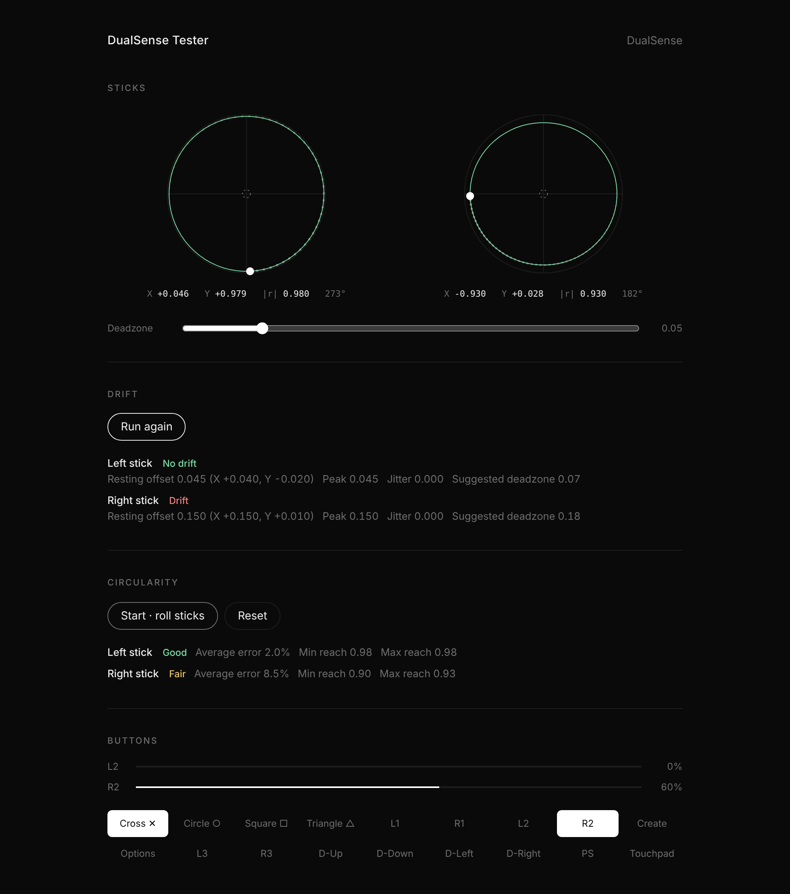
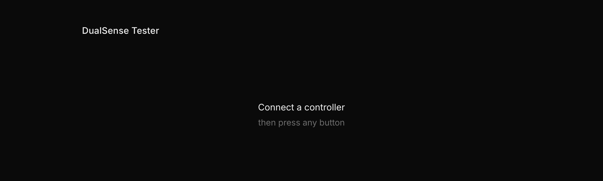
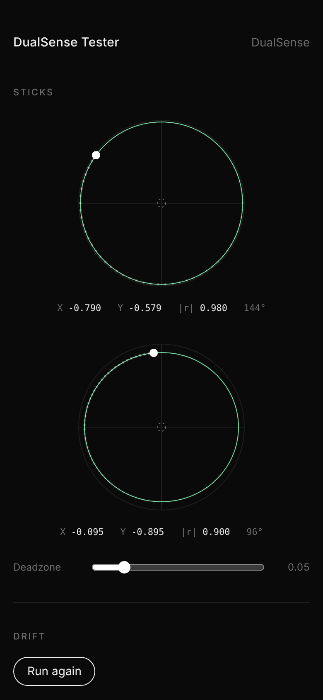

# DualSense Tester

A minimalist controller tester that runs in the browser. No build step, no dependencies.

**Live:** https://teerasak-mairoddee.github.io/dualsense-tester/



- **Sticks:** live position, trail, and an adjustable deadzone ring
- **Drift test:** samples both sticks at rest for 3 s and reports offset, peak, jitter and a suggested deadzone
- **Circularity test:** roll each stick around its edge to get an average error against a perfect circle
- **Buttons & triggers:** every button lights up and stays highlighted once pressed; L2/R2 show analog travel

Uses the Gamepad API, so it works with most controllers.

| Waiting for a controller | On a phone |
| --- | --- |
|  |  |

## Structure

```
index.html                 tester page
assets/
  css/
    base.css               design tokens, reset, typography
    components.css         sections, buttons, sliders, results
    tester.css             sticks, trigger bars, button grid
    case.css               case page styles (generated)
  js/
    main.js                entry point and per-frame loop
    config.js              tunables and the DualSense button map
    core/
      dom.js               DOM and formatting helpers
      gamepad.js           controller discovery and selection
    features/
      sticks.js            stick drawing and deadzone
      drift.js             drift test
      circularity.js       circularity test
      buttons.js           button grid and trigger bars
    case/                  case page scripts (generated)
case.html                  case page (generated)
docs/screenshots/          README images
```

## Run locally

The scripts are ES modules, so serve the folder rather than opening the file directly:

```
python3 -m http.server
```

Then open http://localhost:8000.
